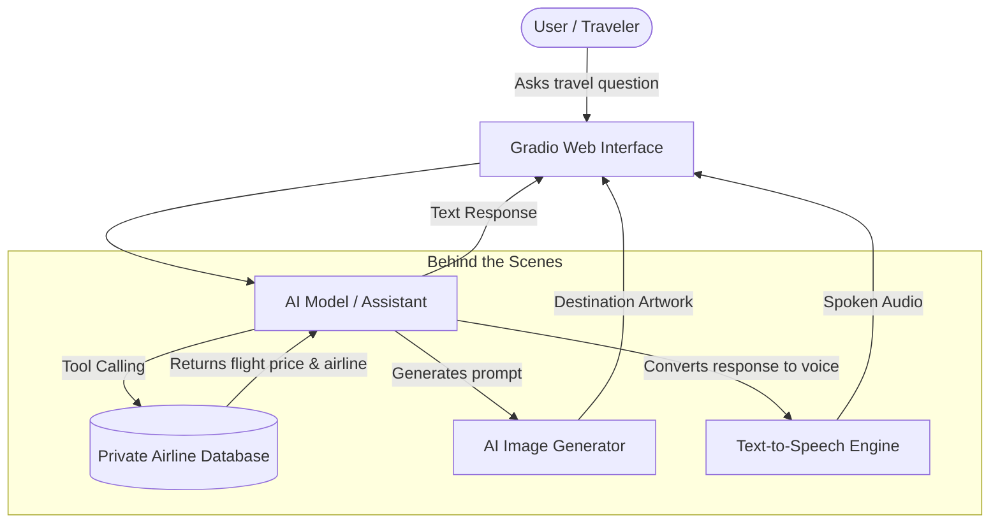

# ✈️ Multi-Model AI Agent & Airline AI Assistant

[](https://www.python.org/)
[](https://gradio.app/)
[](https://openai.com/)
[](https://www.sqlite.org/)
[](https://ollama.ai/)

A practical AI project exploring multiple language models, tool integrations, and interactive interfaces, culminating in an end-to-end **Multimodal Airline AI Assistant**.

---

## 📌 Overview

This project brings together core modern AI capabilities across dedicated notebooks:

* **`ai_models.ipynb`**: Experimenting with different frontier and open LLMs (OpenAI, Google Gemini, Groq, Grok).
* **`ollama_test.ipynb`**: Testing local, privacy-focused open-source models offline using Ollama.
* **`tool_calling.ipynb`**: Integrating external tools and function calling with AI models to perform real-world actions.
* **`gradio.ipynb`**: Designing interactive, user-friendly web interfaces for AI applications.
* **`Airline_AI_Assistant.ipynb`**: The flagship end-to-end multimodal project combining all the techniques above into a functional travel assistant.

---

## ✈️ Airline AI Assistant

The **Airline AI Assistant** is an intelligent, multimodal travel planning agent designed to help users search and plan trips through a conversational web interface.

### How It Works Behind the Scenes

1. **Trip Planning Conversation:**  
   The user chats naturally with the assistant (e.g., *"I want to fly from Berlin to Paris"*).

2. **Private Database Retrieval (Tool Calling):**  
   Behind the scenes, the AI model identifies the departure and destination cities and calls a custom database tool. It queries a private SQLite database (`airline_database.db`) to retrieve available flight routes, ticket prices, and airline operators.

3. **Destination Image Generation:**  
   For any queried destination, an AI image generation model creates a vibrant, customized artwork representing the destination city and its landmarks.

4. **Voice Audio Delivery:**  
   The assistant's response is converted into natural spoken audio using a Text-to-Speech (TTS) model with automatic playback.

5. **Unified Gradio Web Interface:**  
   The user receives the full multimodal experience in one interactive screen: the conversational chat history, the generated destination visual, and the voice response.

---

## 🏛️ Architecture Flow



---

## ⚙️ Quick Setup

1. **Install Dependencies:**
   ```bash
   pip install -r requirements.txt
   ```

2. **Configure API Keys:**
   Copy `.env.example` to `.env` and add your keys:
   ```env
   OPENAI_API_KEY=your_openai_api_key_here
   GOOGLE_API_KEY=your_google_api_key_here
   GROQ_API_KEY=your_groq_api_key_here
   ```

3. **Run:**
   Open [**`Airline_AI_Assistant.ipynb`**](Airline_AI_Assistant.ipynb) in your notebook editor and run the cells to launch the Gradio web assistant.
